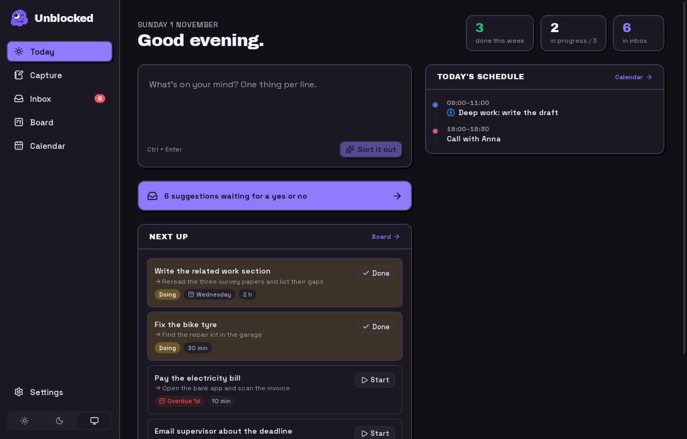
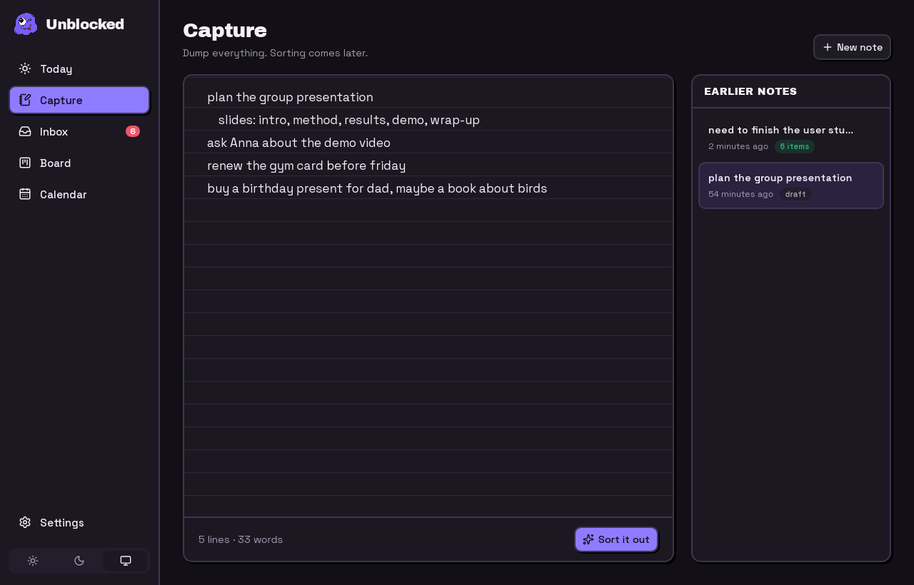
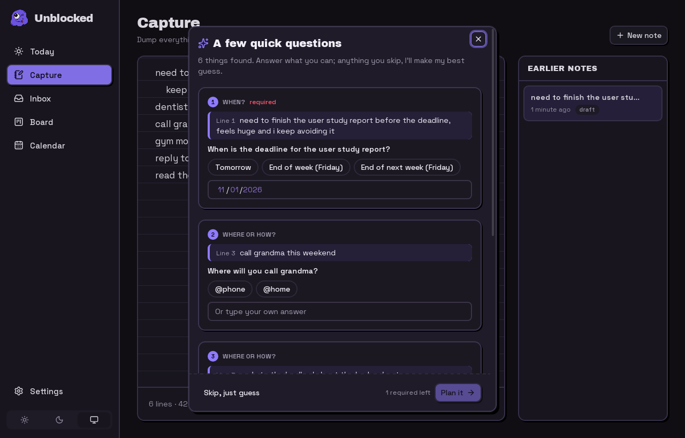
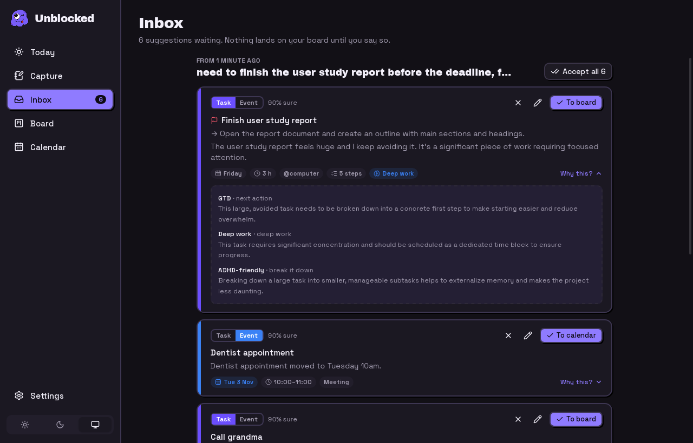
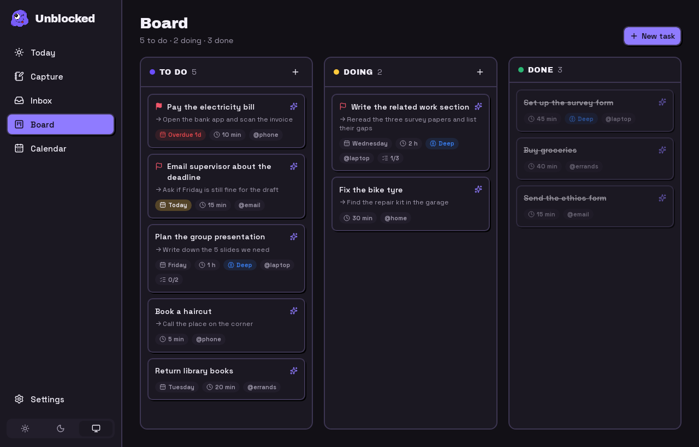
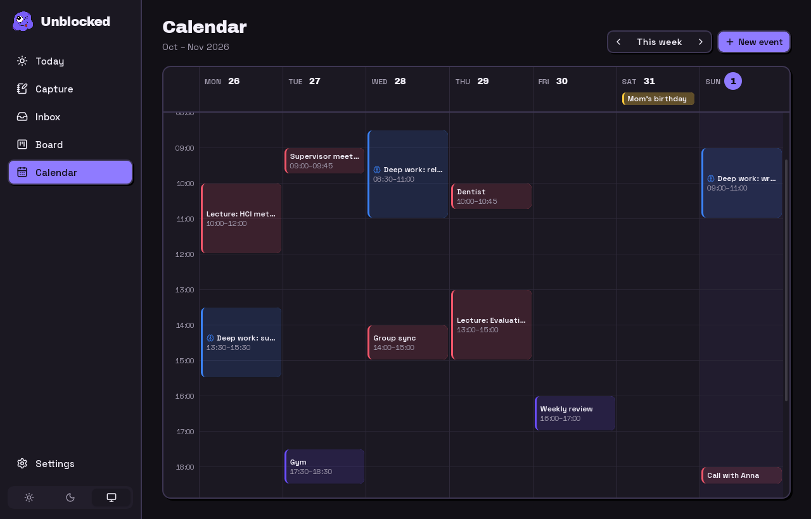
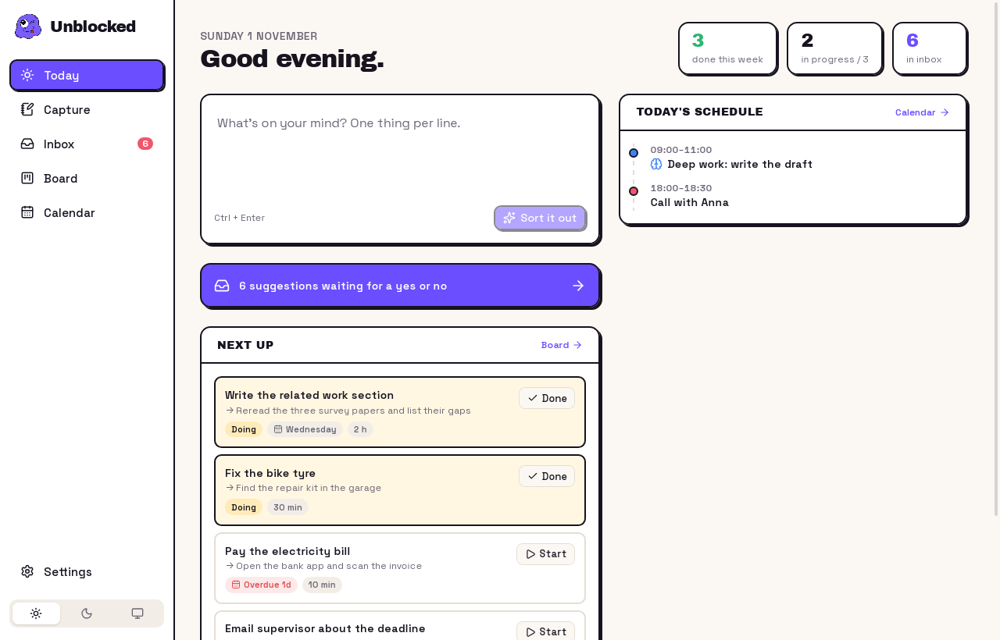
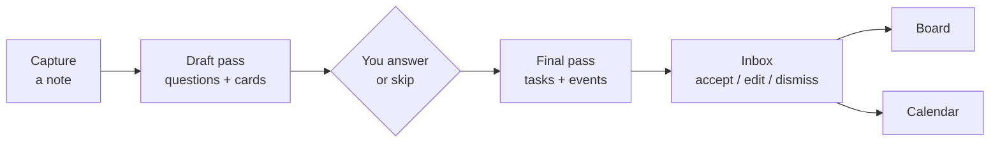

<p align="center">
  
</p>

<h1 align="center">Unblocked</h1>

<p align="center">
  Dump everything on your mind. Get back a plan.<br>
  A desktop planner that turns a messy note into tasks on a board and events on a calendar.
</p>

<p align="center">
  <a href="https://unblocked.lat0s.com"></a>
</p>

<p align="center">
  <a href="https://github.com/lat0s/unblocked-app/actions/workflows/ci.yml"></a>
  
  
</p>

<p align="center">
  
</p>

> Built as a course project for **TIA410**, developed solo.

**Live demo:** [unblocked.lat0s.com](https://unblocked.lat0s.com) runs the UI in your browser with sample data. It has no AI key, so "Sort it out" is off there: clone the repo, build the app and use your own key.

## Why

Planning apps assume you already know what your tasks are. When your head is full, the hard part is getting from "everything at once" to "the next thing to do". Unblocked starts there. You write the mess down as it comes. The app asks a few short questions only where something is unclear, then suggests tasks and events. Nothing lands on your board or calendar until you say yes.

## What it does

| | |
| --- | --- |
| **Capture** | A plain ruled notepad. One thought per line, autosaved, with a history of earlier notes. |
| **Sort it out** | The AI reads the note and asks up to five quick questions, only about what it cannot guess: a date, a time, a context. Every question quotes the line it is about. You can skip it all and let it guess. |
| **Inbox** | Suggestions wait here. Edit, flip task ↔ event, dismiss or accept one by one or all at once. Each one says how sure the AI is and why it suggested it. |
| **Board** | Kanban with To do, Doing and Done, a work-in-progress limit of 3, drag and drop, priorities, estimates, contexts, subtasks and a concrete next action. |
| **Calendar** | Week view with meetings, time blocks and reminders. Deep-work blocks stand out. |
| **Today** | What to do now: tasks in progress, overdue and due today, today's schedule, and a quick capture box. |

The suggestions lean on a few well-known planning methods: getting things done (a clear next action), deep work (protected focus blocks), small habits, ADHD-friendly steps (short tasks, external cues) and personal kanban (limit work in progress). "Why this?" on each suggestion names the method and how it applies.

<table>
  <tr>
    <td></td>
    <td></td>
  </tr>
  <tr>
    <td></td>
    <td></td>
  </tr>
  <tr>
    <td></td>
    <td></td>
  </tr>
</table>

## Private by default

- Notes, tasks and events live in one SQLite file on your computer.
- Only the note you choose to sort is sent to the AI provider, together with the current date and time.
- API keys are stored in the system keyring (Secret Service, macOS Keychain, Windows Credential Manager), never in the database.

## Install

```bash
git clone https://github.com/lat0s/unblocked-app
cd unblocked-app
scripts/install.sh --deps        # --deps installs build packages with sudo (Arch, Debian/Ubuntu, Fedora, openSUSE)
```

This builds from source and installs into `~/.local`: the binary, icons and an "Unblocked" launcher entry. Remove it with `scripts/uninstall.sh` (add `--purge` to delete your data too).

On macOS or Windows, install the [Tauri prerequisites](https://v2.tauri.app/start/prerequisites/), then `pnpm install && pnpm package`.

### Install with an AI coding agent

The repo ships an agent skill: [skills/unblocked](skills/unblocked/SKILL.md). Point your agent at it:

> Install https://github.com/lat0s/unblocked-app on this machine. Follow `skills/unblocked/SKILL.md` from the repo and ask me before anything that needs sudo.

## Set up the AI

Open **Settings** and pick a provider:

| Provider | Key | Default model |
| --- | --- | --- |
| Gemini | [aistudio.google.com/apikey](https://aistudio.google.com/apikey) | `gemini-2.5-flash` |
| OpenRouter | [openrouter.ai/keys](https://openrouter.ai/keys) | `google/gemini-2.5-flash` |

Paste the key, press **Test connection**, done. Any model with structured (JSON) output works. Keys can also come from `GEMINI_API_KEY` or `OPENROUTER_API_KEY`.

With Gemini you can optionally point it at a File Search store with your own reference files, so explanations can quote them. Without one it uses short built-in notes on each method.

## How it works



- **Two passes.** The first pass only finds what is unclear and asks about it. The second pass turns the note and your answers into items. Both use a strict JSON schema, so the reply is checked, not parsed from prose.
- **The model suggests, the code decides.** Every reply is validated and cleaned: bad dates turn an event back into a task, estimates are clamped, end times must follow start times.
- **Nothing is final until you accept it.** Accepting is one transaction: the item lands on the board or calendar, or nothing changes.
- **Vertical slices.** Each feature owns its tables, commands and UI. Adding one does not touch the others.

Details and diagrams: [docs/ARCHITECTURE.md](docs/ARCHITECTURE.md).

## Development

```bash
pnpm install
pnpm dev            # app with hot reload
pnpm web           # web demo in the browser (sample data, no AI)
pnpm test           # Vitest + cargo test
pnpm run check      # types, lint, format, clippy
pnpm build          # release binary in src-tauri/target/release/
```

Stack: Tauri 2, Rust, SQLite, React 19, TypeScript, TanStack Query, Tailwind 4, shadcn/ui on Base UI, Vite+ (Vite, Oxlint, Oxfmt, Vitest).

```
src-tauri/src/<feature>/   logic, commands.rs, schema.sql    src/features/<feature>/   page, api.ts, logic + tests
src-tauri/src/core/        db, errors, logging               src/shared/               ipc, query, format, ui
src-tauri/src/ai/          Gemini + OpenRouter clients       skills/                   agent skill and playbooks
```

## License

MIT © George Latos
