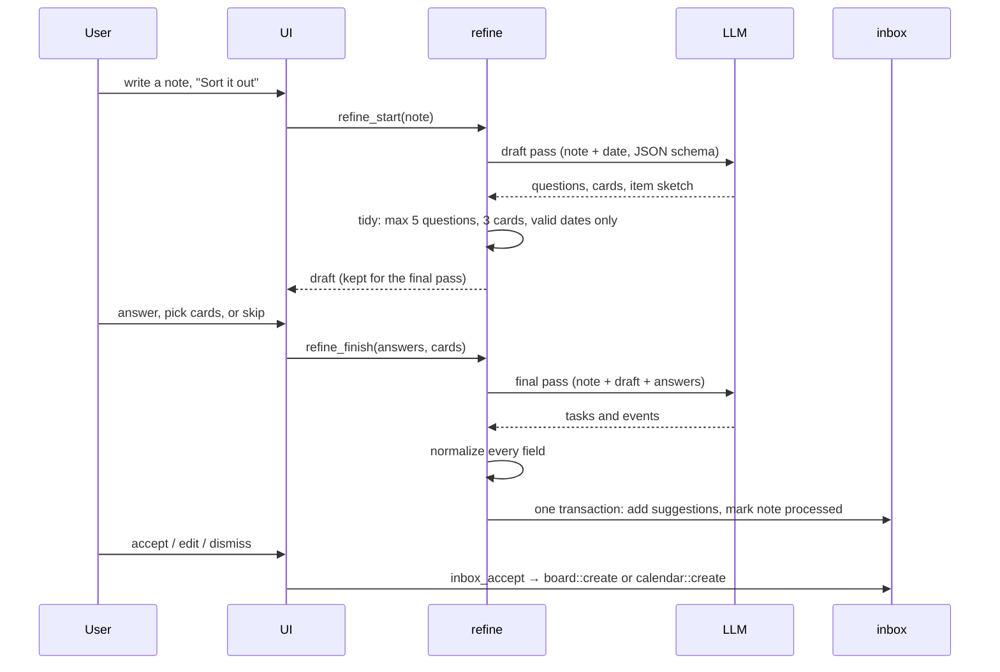

# Architecture

Unblocked is a Tauri 2 app: a Rust backend that owns the data and talks to the AI provider, and a React UI that renders it. This page explains how the pieces fit and why.

## Shape of the code

The code is organized by feature, not by layer. Each feature is a vertical slice that owns its tables, its Tauri commands and its UI:

```
src-tauri/src/                        src/
├── core/     db, errors, logging     ├── shared/            ipc, query, format, methods, ui
├── ai/       Gemini + OpenRouter     ├── features/settings/ provider, key, model
├── capture/  notes                   ├── features/capture/
├── refine/   prompts, schemas, flow  ├── features/refine/   question wizard
├── inbox/    suggestions             ├── features/inbox/
├── board/    tasks                   ├── features/board/
├── calendar/ events                  ├── features/calendar/
│                                     ├── features/today/    built from the others
└── lib.rs    migrations + commands   └── app/               shell, page registry, error boundary
```

Each backend slice is `mod.rs` (logic), `commands.rs` (thin Tauri adapter) and `schema.sql` (its tables). Each frontend slice is a page plus `api.ts` (typed commands and React Query hooks) with pure helpers and tests next to them.

Rules that keep the slices independent:

- `core` and `shared` never import a feature.
- `commands.rs` only moves work off the UI thread (`core::blocking`) and passes results through. Logic is plain functions over a `rusqlite::Connection`, unit-tested on an in-memory database.
- A slice registers three things: its migration in `lib.rs`, its commands in `generate_handler!`, and its page in `src/app/pages.tsx`.
- Slices talk through public functions, never each other's tables. The inbox calls `board::create` and `calendar::create`; it does not insert into `tasks`.

## From note to plan



Decisions worth knowing:

- **Ask little.** The draft pass is told to ask only when the answer changes the outcome, and never about something the note already says. The code caps it at five questions. Each question carries the line numbers it is about, so the UI can quote the user's own words.
- **Schemas, not prose.** Both passes send a JSON schema (`refine/schema.rs`). Every property is required and nullable where it can be empty, because some providers silently drop optional fields.
- **The code has the last word.** `to_proposal` cleans every item: an event without a valid date becomes a task, estimates are clamped to 5–600 minutes, contexts get an `@`, end time must follow start time, confidence stays in 0–1.
- **No lock during network calls.** The database lock is held only to read the note and to write the results, never while waiting for the model.
- **One retry.** A reply that does not parse is retried once, then reported as a `provider` error.
- **Human in the loop.** Suggestions go to the inbox, not the board. Accepting is one transaction, so an item is either placed or untouched.

## AI providers

`ai/` hides the provider behind one trait:

```rust
trait Llm { fn json(&self, req: &JsonRequest) -> AppResult<Value>; }
```

- **Gemini**: `generateContent` with `responseJsonSchema`. With a File Search store set, it adds the `fileSearch` tool and puts the schema in the prompt instead (the API does not allow both).
- **OpenRouter**: `chat/completions` with `response_format: json_schema`.
- Keys come from the system keyring first, then `GEMINI_API_KEY` / `OPENROUTER_API_KEY`. They are never stored in SQLite and never sent to the UI.
- Tests use a fake `Llm`, so the whole refine flow is tested without a network.

## Data

One SQLite file (WAL mode, foreign keys on) at `$XDG_DATA_HOME/unblocked/unblocked.db`. `UNBLOCKED_DB` points it somewhere else (demos, a second profile). Each slice owns its tables:

| Slice | Tables |
| --- | --- |
| core | `migrations`, `kv` (settings) |
| capture | `notes` |
| refine | `note_drafts` (draft kept between the two passes) |
| inbox | `inbox_items` (suggestion JSON, status) |
| board | `tasks` |
| calendar | `events` |

Migrations are named per slice and run once at start-up.

## Errors and logs

- Every command returns `AppResult<T>`. `AppError` crosses IPC as `{ kind, message }` with kinds `notConfigured`, `notFound`, `invalidInput`, `provider` and `failed`. The UI treats `notConfigured` as a normal state and offers a button to Settings.
- `core::blocking` runs work off the UI thread and logs failures. A panic hook logs a backtrace.
- UI errors (`window.onerror`, unhandled rejections, the error boundary) go to the same log through the `log_client` command.
- Logs live in `$XDG_STATE_HOME/unblocked/logs/` (1 MiB, one rotated copy). `UNBLOCKED_LOG=debug` raises the level.

## Testing

- **Rust**: every slice is tested on an in-memory database. The refine tests run the full start → finish flow against a fake model, including bad replies.
- **TypeScript**: grouping, ordering, labels and formatting are pure functions with Vitest tests.
- CI runs `cargo fmt`, `clippy -D warnings`, both test suites and a release build on Ubuntu 24.04.
